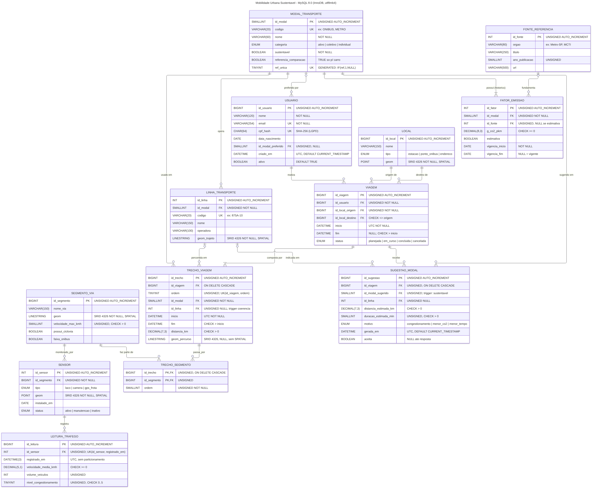

# Projeto A3 – Banco de Dados: Mobilidade Urbana Sustentável

Solução em **MySQL 8.0** (InnoDB, utf8mb4) para monitorar tráfego em tempo real, histórico de deslocamentos, sugestão de modais sustentáveis e cálculo de emissões de CO₂e — tema *Mobilidade Urbana Sustentável* (São Paulo).

## Como executar

### Opção A – Docker Compose (recomendado)

```bash
docker compose up -d
# aguarde o healthcheck
docker compose exec mysql mysqladmin ping -h127.0.0.1 -uroot -prootpass

# Script único (do zero):
docker compose exec -T mysql mysql -uroot -prootpass < sql/script_completo.sql

# Ou scripts numerados:
MYSQL_HOST=127.0.0.1 MYSQL_PWD=rootpass ./scripts/run_all.sh
```

### Opção B – MySQL 8 local

```bash
# regenerar o script único (se alterou os numerados)
./scripts/build_script_completo.sh

# caminho completo:
mysql -h127.0.0.1 -uroot -prootpass < sql/script_completo.sql

# ou numerados em ordem:
MYSQL_PWD=rootpass ./scripts/run_all.sh
```

Senha de root usada nos exemplos acadêmicos: `rootpass`.  
Usuários de aplicação (script `05`): `app_mobilidade` / `analista_mobilidade` / `admin_mobilidade` (senhas no próprio script — trocar em produção).

Saída real de uma execução nesta VM: [`docs/execucao.txt`](docs/execucao.txt).

## Estrutura do repositório

```
sql/
  01_schema.sql          # DATABASE + 13 tabelas + PK/FK/UNIQUE/CHECK + índices (incl. SPATIAL)
  02_views.sql           # CO₂ por trecho/viagem/usuário/modal/linha + economia vs carro
  03_triggers.sql        # Sobreposição de fator, coerência modal×linha, sugestão sustentável
  04_procedures.sql      # sp_registrar_viagem, sp_gerar_sugestao_sustentavel, EVENT limpeza
  05_security.sql        # roles (app / analista / admin) + users + GRANTs
  06_seed.sql            # dados SP (fictícios) + fatores exatamente de docs/normalizacao.md
  07_relatorios.sql      # consultas de relatório
  08_testes.sql          # provas de rejeição (CHECK/FK/trigger) + rollback de transação
  09_monitoramento.sql   # performance_schema / sys (administração)
  script_completo.sql    # GERADO – não editar à mão
scripts/
  build_script_completo.sh   # concatena 01–08 → script_completo.sql
  run_all.sh                 # executa 01–08 em ordem
  backup_restore_exemplo.sh  # mysqldump + notas de PITR via binlog
docs/
  er.png / er.mmd        # modelo ER aprovado (13 tabelas, 3FN)
  normalizacao.md        # dicionário, restrições e decisões MySQL
  enunciado.md           # enunciado do projeto
  execucao.txt           # console real da execução
docker-compose.yml
```

### Script completo (`sql/script_completo.sql`)

A **fonte da verdade** são os arquivos numerados `01`–`08`. O script único é gerado por:

```bash
./scripts/build_script_completo.sh
```

Ele prefixa `DROP DATABASE IF EXISTS mobilidade_urbana;` e concatena os numerados na ordem. Sempre regenere após editar qualquer `0x_*.sql`.

## Justificativa do SGBD (MySQL 8.0)

- **InnoDB**: transações ACID e FKs reais (critério de avaliação).
- **CHECK** efetivo desde 8.0.16.
- Tipos espaciais nativos (`POINT`/`LINESTRING`, SRID 4326, `SPATIAL INDEX`) e funções geodésicas.
- Window functions/CTEs, triggers, procedures, EVENT scheduler, `CREATE ROLE`.
- Gratuito e amplamente usado no mercado/curso — viável técnica e financeiramente.

Detalhes e decisões (sem particionar `leitura_trafego` para manter FK, coluna gerada `ref_unica`, `axis-order=long-lat`, CHECKs sem ação referencial em colunas FK): ver [`docs/normalizacao.md`](docs/normalizacao.md).

## Modelo ER



Fonte Mermaid: [`docs/er.mmd`](docs/er.mmd). **13 tabelas** em 3FN. Valores de CO₂/economia **não são armazenados** — calculados em views com o fator vigente na data do trecho.

## Segurança, backup e monitoramento

- Roles de menor privilégio: `role_app`, `role_analista`, `role_admin_dados` (`05_security.sql`).
- Backup lógico: `./scripts/backup_restore_exemplo.sh` (`mysqldump --single-transaction --routines --triggers --events`).
- Point-in-time: anotar `SHOW BINARY LOG STATUS` no dump e aplicar `mysqlbinlog` até `--stop-datetime` (binlog habilitado no `docker-compose.yml`).
- Monitoramento: `sql/09_monitoramento.sql` (performance_schema / sys).

## Desvios do modelo aprovado

Nenhum desvio estrutural das 13 tabelas. Complementos documentados (não alteram a 3FN do modelo):

- Views extras de relatório (`vw_emissao_usuario`, `vw_emissao_modal`, `vw_emissao_linha`, `vw_economia_vs_carro`, `vw_taxa_aceitacao_sugestao`) além das previstas no texto de normalização.
- Trigger adicional: viagem `concluida` exige ≥1 trecho e `fim` preenchido.
- Functions auxiliares `fn_fator_vigente` / `fn_co2_estimado_g`.
- Script `09_monitoramento.sql` e usuários/roles de demonstração (fora do DER).
